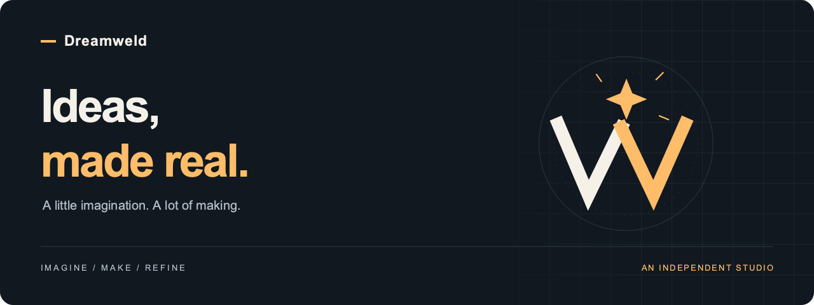

  

  <strong>逐光工坊 · Dreamweld</strong> 
  逐心中之光，造未有之物。

---

### A studio for things worth making.

We're an independent studio turning ambitious ideas into useful software. We use AI to shorten the distance between **“what if”** and **“here it is”** — with thoughtful design, practical engineering, and room to experiment.

我们相信，好想法值得被做出来。借助 AI，把灵感变成可触摸、可使用、可持续打磨的作品。

 

| Imagine | Make | Refine |
| :--- | :--- | :--- |
| Start with curiosity. 从一个值得追问的问题出发。 | Build something useful. 把想象做成真正有用的东西。 | Keep making it better. 在真实使用中，持续打磨。 |

 

### Follow the making.

This is where we'll share our public projects and experiments as they take shape.

这里将陆续记录我们的开源项目、探索与创造。

**[Explore our repositories ↗](https://github.com/orgs/Dreamweld/repositories)**

---

  Dream boldly. Make thoughtfully.

